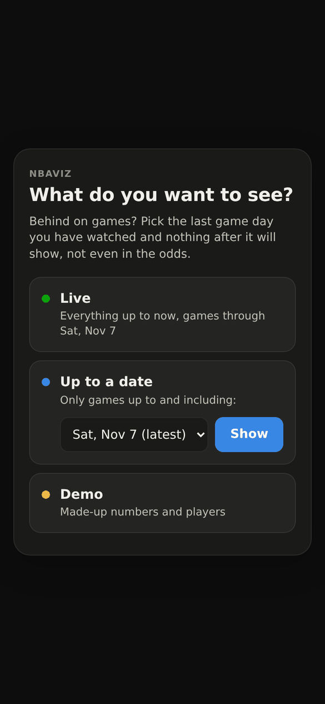
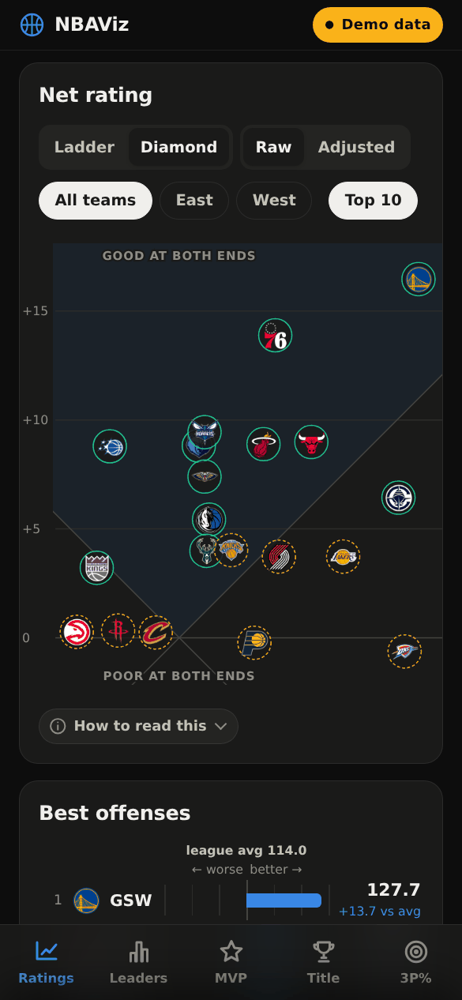
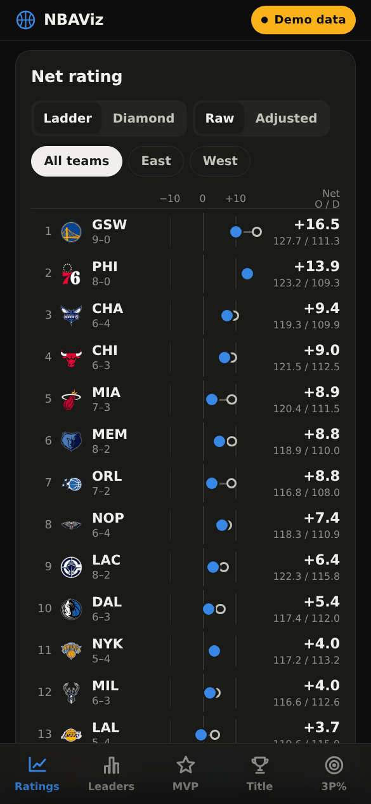
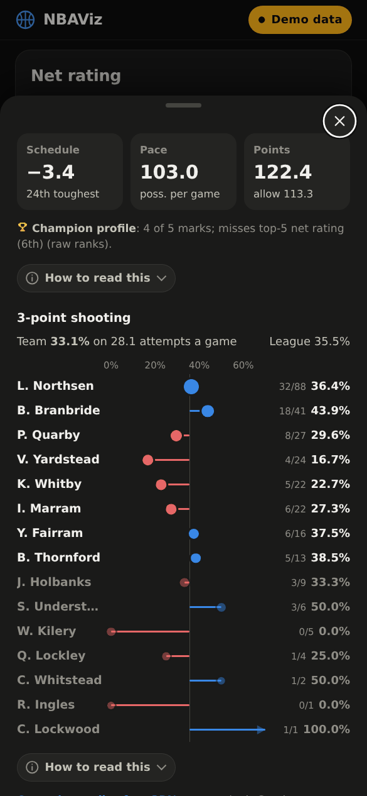
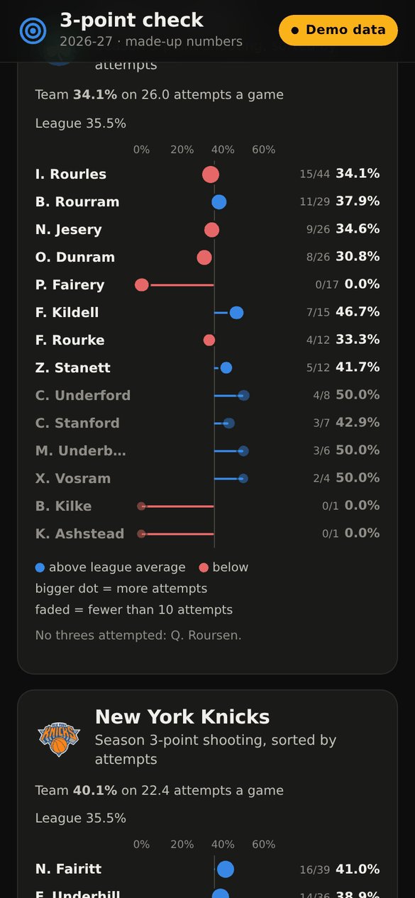
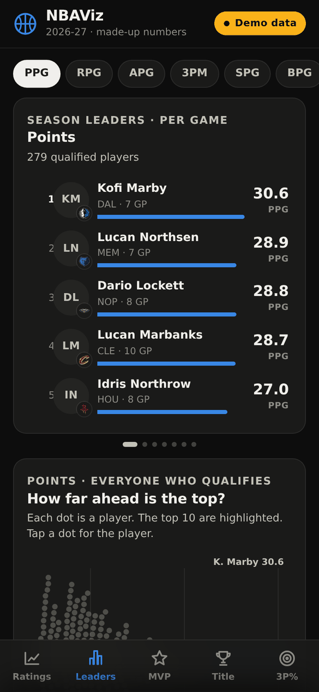
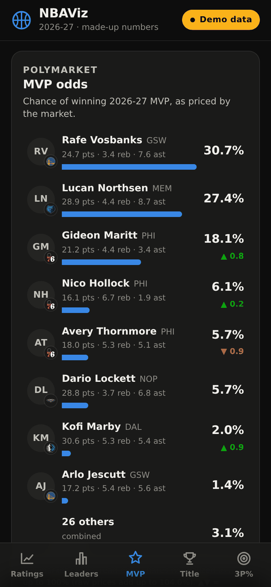
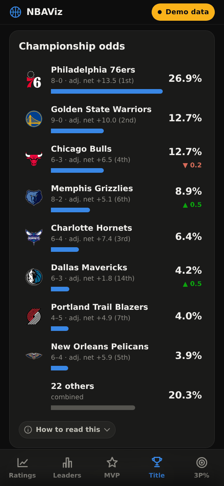

# NBAViz

*Repository: [NBA-Spoiler-Free-Viz](https://github.com/whysoserious321/NBA-Spoiler-Free-Viz)*

A small, mobile-first NBA dashboard that runs on a Raspberry Pi. It shows how good
every team really is (net rating, raw and **opponent-adjusted**), who leads the league,
what the betting market thinks about the title and MVP races, and every player's
3-point shooting. It includes a **spoiler-free 3P% page** you can open while watching a game, and
every visit starts by asking whether you want **live data or everything only up to a date**, so you
can catch up on games without being spoiled.

Flask + vanilla JavaScript + hand-written SVG. No build step, no front-end dependencies,
no database. One refresh a day of about 20 polite requests (a few more on mornings when ESPN
is slow to update its season totals).

<p align="center">
  
  
  
  
</p>
<p align="center">
  
  
  
  
</p>

> All screenshots use the built-in demo mode: every number and every player in them is made up.

## Features

- **Live, or up to a date.** Every page load starts with a short question: *Live*, *Up to a date*, or
  *Demo*. Pick the last game day you have watched and the whole app (ratings, records, leaders, odds,
  odds trends and the 3P% page) shows only what was known the morning after it. The start screen
  also links straight to the spoiler-free 3P% page. See [Live or up to a date](#live-or-up-to-a-date).
- **Net rating diamond.** Offensive vs. defensive rating rotated 45° so that *height is net rating*
  (after Owen Phillips' "diamond plots" in The F5), with a small drawn key above it showing how to read it. Switch between raw and opponent-adjusted
  ratings and filter by conference; the view fits the teams on show and glides between states.
  Pinch, double-tap or use +/− to zoom. Logos keep their size, so a crowded middle spreads out.
- **Ladder.** The same ratings as a ranked list: a ring for the raw net rating, a dot for the adjusted
  one, so you can see whose schedule flattered them.
- **Team sheet.** Offense, defense and net rating (adjusted and raw, with league ranks), strength of
  schedule, pace, and a compact 3P% chart for every player on the roster.
- **Spoiler-free 3P% page** (`/threes`). Pick one or two teams, or tap one of today's matchups, and see
  each player's season 3-point shooting. The page loads its own minimal JSON, so it never receives
  scores, records, ratings, standings or odds. It asks the same live / up-to-a-date question, has the
  same bottom tab bar as the dashboard, and can be installed on its own home-screen icon.
- **Season leaders.** Points, rebounds, assists, 3-pointers made, steals, blocks and true shooting:
  a top-5 card per stat plus a beeswarm of every qualified player, so you can see how far ahead the leader is.
- **MVP and championship odds** from Polymarket: shares normalised to 100%, 24-hour change,
  price history, and a "market vs. court" chart of title odds against adjusted net rating.
- **Demo mode**, the third start-screen option: invented numbers and fictional players, for
  screenshots or for a first look before any real data exists.
- Dark and light themes, installable PWA, works offline with the last data it saw.

## Live or up to a date

ESPN's season totals always mean "up to now", so the app keeps its own history: every morning's
refresh saves the whole dashboard as a **snapshot** for the last game day it contains
(`data/snapshots/YYYY-MM-DD.json.gz`). When you choose *Up to a date*, everything is served from that
snapshot:

- ratings, adjusted ratings, records, leaders, every player's 3P%, and the title and MVP odds are
  exactly what the app knew the morning after that day;
- the odds trend lines stop at that moment, so no later movement shows;
- the 3P% page shows the *next* day's matchups (the games you are about to watch).

The start screen lists only days that were saved. If you watched through a day that is not listed,
pick the closest earlier one. The header pill (*Live*, *To Nov 7* or *Demo data*) shows the current
choice; tap it to change. Links between the dashboard and the 3P% page keep the choice, including
the bottom tab bar on the 3P% page: with *Live* chosen there, tapping *Ratings*, *Leaders*, *MVP* or
*Title* opens the live dashboard without asking again.

Rules that keep snapshots spoiler-safe:

- A snapshot is only written when every game of that day is final and the next day's games have not
  started. A refresh in the middle of a game night does not write one.
- A later refresh for the same day replaces it. That is how the hourly catch-up fixes a morning when
  ESPN's season totals still lagged; if they never catch up before 14:00, that day's ratings miss
  the last games for a few teams, and the team sheet says so.
- Days before you installed NBAViz cannot be recovered, because ESPN only offers season-to-date totals.

Storage is small: about 37 KB per day compressed, roughly 6 MB for a whole regular season. Snapshots
are kept until you delete them; removing a file simply removes that day from the list.

## Reading the diamond

```
              ↑ better net rating
     better defense ↖       ↗ better offense

                good at both ends
                 (shaded zone)
   defense-first  ╲         ╱  offense-first
                   ╲       ╱
                    ╲     ╱
                     ╲   ╱
                      ╲ ╱
                      ╱ ╲
                poor at both ends
```

- **Higher is better.** A team's height is its net rating, so teams at the same height are equally
  good, whether they get there with offense (further right) or defense (further left).
  There is no single "optimal line". The best team is simply the highest one.
- The two diagonals are the **league-average offense** and **league-average defense**. Teams in the
  shaded top zone are better than average at both ends; teams at the bottom are worse at both.
- Horizontal gridlines are net rating: +5, 0, −5 and so on.
- In *Adjusted* mode, small rings show where each team sat before the schedule adjustment.

## How the ratings are computed

The definitions follow Basketball-Reference's glossary; the numbers are computed from ESPN's season totals.

**Possessions** (per team, averaged with the opponent's estimate):

```
poss = FGA + 0.4·FTA − 1.07·(ORB / (ORB + opp DRB))·(FGA − FG) + TOV
```

**Ratings:** `ORtg = 100·points / poss`, `DRtg = 100·points allowed / poss`, `NRtg = ORtg − DRtg`.

**Opponent adjustment** (SRS-style). Each team's raw ratings are modelled as its own quality plus
the average quality of the opponents it has played:

```
ORtg_i = lg + o_i + mean(d_j over opponents j)
DRtg_i = lg + d_i + mean(o_j over opponents j)
solved exactly, with Σo = Σd (adjusted net ratings average to zero)
```

`ORtg/A = lg + o_i` and `DRtg/A = lg + d_i` are what the team would post against a league-average
schedule. Early in the season the adjustment can move a team by several points; over a full season
raw and adjusted net ratings end up very close.

Strength of schedule is the average adjusted net rating of the opponents a team has faced.
ESPN's season totals can lag the scoreboard by a game for a few hours after games end; the
adjustment only counts the opponents of games the totals already include, and the team sheet says
when ratings cover fewer games than the record.

## Quick start

Requires Python 3.9+.

```bash
git clone https://github.com/whysoserious321/NBA-Spoiler-Free-Viz.git
cd NBA-Spoiler-Free-Viz
pip install -r requirements.txt
python3 app.py
```

Open `http://localhost:5003` and pick *Live*, *Up to a date* or *Demo*. On the first start the app
fetches the season so far (about one to two minutes); until then the page says the first refresh is
still running and checks again by itself. *Demo* works straight away (team logos appear once the first
refresh has downloaded them). The first snapshot for *Up to a date* is saved by the first refresh that
runs after a complete game night.

Adding `?live=1`, `?date=YYYY-MM-DD` or `?demo=1` to a URL skips the start screen, which is handy for
bookmarks.

You can also refresh by hand:

```bash
python3 scrape.py            # fetch and rebuild data/dashboard.json
python3 scrape.py --offline  # rebuild from the cache, no network
python3 demo.py              # regenerate the demo data
```

### Configuration

| Variable | Default | Meaning |
|---|---|---|
| `NBAVIZ_PORT` | `5003` | Port for `python3 app.py` |
| `NBAVIZ_REFRESH_AT` | `08:00` | Daily refresh time, server local time |
| `NBAVIZ_NO_REFRESH` | unset | `1` disables the built-in schedule |

### Refresh schedule

A background thread in the app refreshes once a day at `NBAVIZ_REFRESH_AT`:

- a failed refresh is retried every 30 minutes until it works;
- if ESPN's season totals don't include last night's games yet, it checks again every hour (until 14:00);
- after a restart it refreshes straight away if the data is older than the latest scheduled time.
  A restart does not resume the hourly catch-up, though: if the app is restarted on a morning when the
  totals still lagged, it waits for the next day's run, so run `python3 scrape.py` by hand.

A file lock makes sure only one process runs the schedule. `GET /api/status` shows the next run and the last result.

### Running on boot

Any process manager works. The author's Raspberry Pi starts it from a shell script called by `rc.local`:

```bash
cd /path/to/NBAViz
FLASK_APP=app.py nohup flask run --host=0.0.0.0 --port=5003 &
```

A systemd unit is the tidier option:

```ini
[Unit]
Description=NBAViz
After=network-online.target

[Service]
WorkingDirectory=/path/to/NBAViz
ExecStart=/usr/bin/python3 app.py
Restart=on-failure

[Install]
WantedBy=multi-user.target
```

## Endpoints

| Path | What |
|---|---|
| `/` | Dashboard; asks live / up to a date / demo unless `?live=1`, `?date=YYYY-MM-DD` or `?demo=1` is given |
| `/threes` | Spoiler-free 3-point page, same choice (`#BOS-NYK` preselects teams) |
| `/api/dates` | Saved days you can pick (newest first) and how far live data goes |
| `/api/dashboard` | Everything the dashboard shows, as JSON (`?date=` or `?demo=1` as above) |
| `/api/threes` | Rosters with 3PM/3PA, team 3P% and matchups (today's, or the day after `?date=`). No results of any kind |
| `/api/status` | Refresh schedule status |
| `/img/logos/…`, `/img/heads/…` | Cached team logos and player headshots |

## Data sources

| Data | Source | Requests per refresh |
|---|---|---|
| Team season totals incl. opponent totals | ESPN `statistics/byteam` | 1 |
| Results, to know who played whom | ESPN scoreboard, one per day; finished days are cached forever | 1–2 |
| Player per-game stats | ESPN `statistics/byathlete` (all players and qualified players) | 2 |
| Championship and MVP odds, price history | Polymarket Gamma and CLOB APIs (read-only) | ~14 |
| Logos and headshots | ESPN's image CDN, downloaded once into `data/img/` | 0 after the first run |

Requests go through one session with a clear `User-Agent`, a minimum gap between calls, and a hard
stop on HTTP 429. Basketball-Reference is **not** scraped: it serves automated clients a bot
challenge, and its data-use policy asks people not to build sites on scraped data. stats.nba.com is
not used either, because it is unreliable from home and cloud IP addresses.

Each refresh also saves the day's snapshot (see [Live or up to a date](#live-or-up-to-a-date)) and
merges the fetched odds histories into `data/cache/odds_history.json`, so a past date can still draw
the trend for candidates that have since left the top six.

## Project layout

```
app.py              Flask app, daily refresh schedule, JSON endpoints
scrape.py           fetching and caching (ESPN, Polymarket, images)
model.py            possessions, ratings, opponent adjustment, leaders, odds matching
demo.py             spoiler-free demo data
templates/          index.html (dashboard), threes.html (3P% page)
static/app.js       dashboard: diamond, ladder, leaders, odds, sheets
static/threes.js    spoiler-free 3P% page
static/gate.js      start screen: live, up to a date, or demo (shared by both pages)
static/tpchart.js   the 3P% chart shared by both pages
static/app.css      styles, light and dark
static/sw.js        service worker (network first, offline fallback)
data/               generated, git-ignored: dashboard.json, snapshots/, caches, images
```

## Disclaimer

NBAViz is a personal, non-commercial project. It is not affiliated with or endorsed by the NBA,
ESPN, Polymarket or Sports Reference. Team names and logos are trademarks of their owners; logos
and headshots are fetched at runtime and are not part of this repository. ESPN's JSON endpoints are
undocumented and can change without notice. Odds are shown for information only. This is not
betting advice, and the app has no trading or referral links. If you host it publicly, check the
data providers' terms first.
