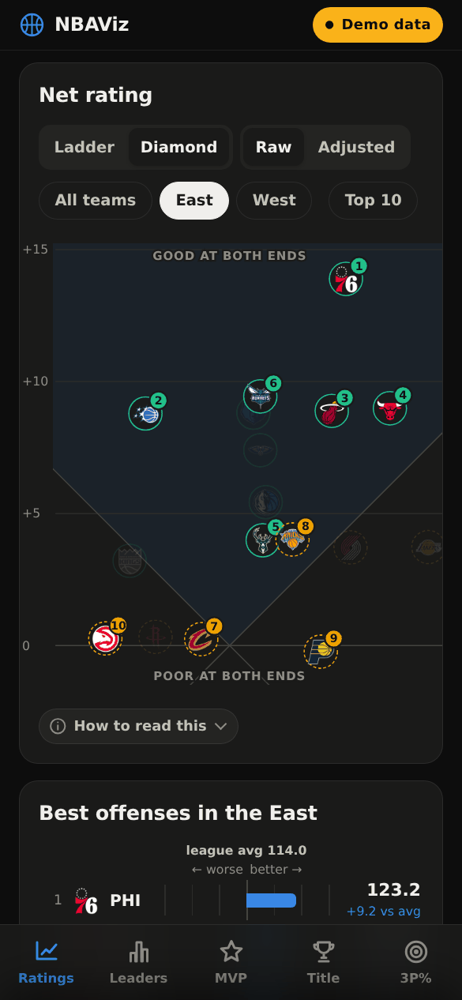
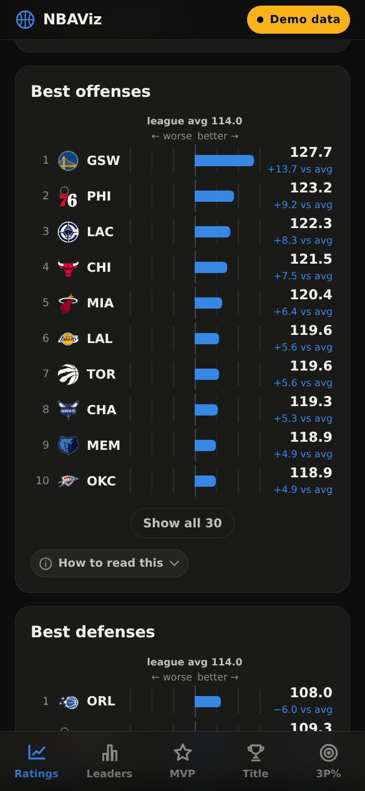
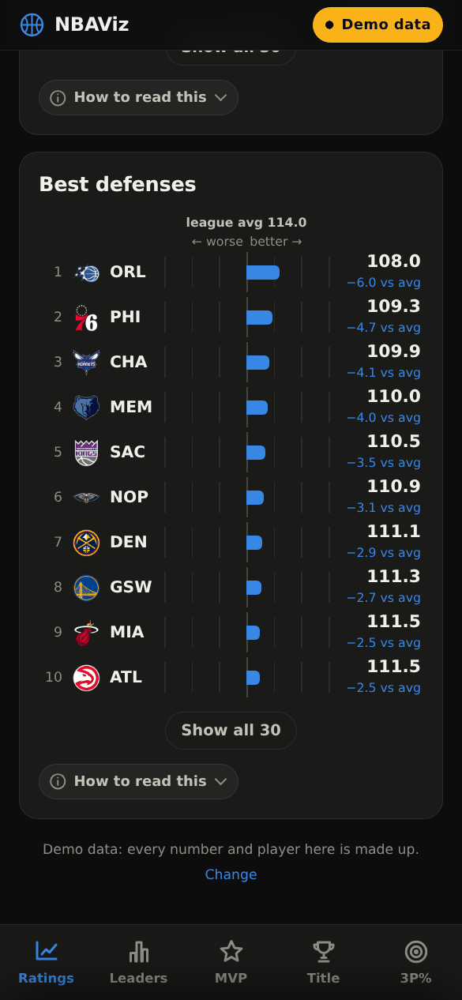
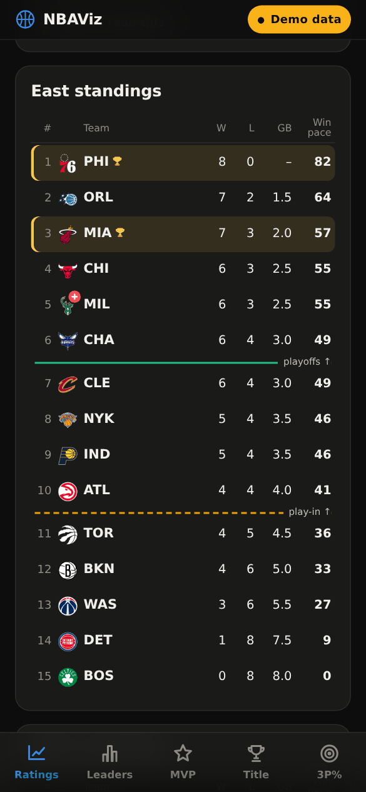
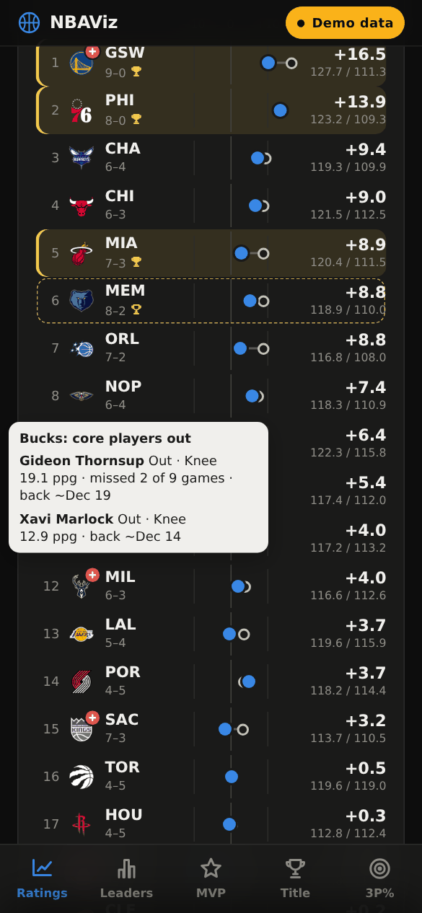
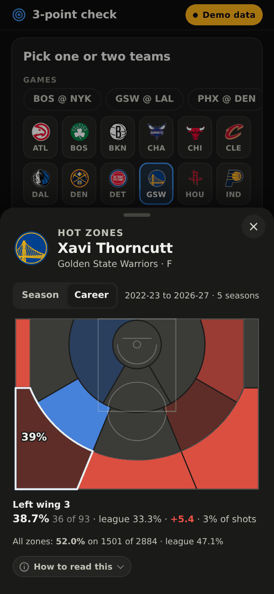

# NBAViz

*Repository: [NBA-Spoiler-Free-Viz](https://github.com/whysoserious321/NBA-Spoiler-Free-Viz)*

A small, mobile-first NBA dashboard that runs on a Raspberry Pi. It shows how good
every team really is (net rating, raw and **opponent-adjusted**), who leads the league,
what the betting market thinks about the title and MVP races, and every player's
3-point shooting. It includes a **spoiler-free 3P% page** you can open while watching a game, and
every visit starts by asking whether you want **live data or everything only up to a date**, so you
can catch up on games without being spoiled.

Flask + vanilla JavaScript + hand-written SVG. No build step, no front-end dependencies,
no database. One refresh a day of about 20 polite requests, plus one per finished game for the shot
locations behind the hot zones (a few more on mornings when ESPN is slow to update its season totals).

<p align="center">
  
  
  
  
</p>
<p align="center">
  
  
  
  
</p>

> All screenshots use the built-in demo mode: every number and every player in them is made up.

## Features

- **Live, or up to a date.** Every page load starts with a short question: *Live*, *Up to a date*, or
  *Demo*. Saved days are listed by the time of their refresh in your own time zone; pick the last one
  before the games you haven't watched and the whole app (ratings, records, leaders, injuries, odds,
  odds trends and the 3P% page) shows only what was known then. The start screen
  also links straight to the spoiler-free 3P% page. See [Live or up to a date](#live-or-up-to-a-date).
- **Net rating diamond.** Offensive vs. defensive rating rotated 45° so that *height is net rating*
  (after Owen Phillips' "diamond plots" in The F5), with a small drawn key showing how to read it. Switch between raw and opponent-adjusted
  ratings and filter by conference; the view fits the teams on show and glides between states.
  Pinch or double-tap to zoom (with a mouse, +/− buttons or ctrl+scroll). Logos keep their size, so a crowded middle spreads out.
  A ring around each logo shows the **standings**: green for a top-6 playoff spot, dashed amber for
  the play-in (7–10), none for the rest, which are hidden by default. Filter to East or West and every
  logo also shows its seed.
- **Best offenses and defenses.** Under the diamond, two ranked charts show how far each team's offense
  and defense are from the league average, best at the top, with bars to the right meaning better on both
  (for defense, fewer points allowed). They follow the Raw / Adjusted switch and the conference filter,
  show the top 10, and expand to every team.
- **Ladder.** The same ratings as a ranked list: a ring for the raw net rating, a dot for the adjusted
  one, so you can see whose schedule flattered them.
- **Standings.** Under the ladder, the real NBA standings per conference: W, L, games behind and
  **win pace** (wins over 82 games at the current winning percentage), with the playoff and play-in
  cut lines. Wider screens add home, away and conference records, the last 10 games and the streak.
- **Champion profile.** In the ladder and the standings, a gold trophy marks teams with the five marks
  nearly every recent champion had: top-3 seed, top-5 net rating, top-10 defense, top-10 offense and a
  52+ win pace (filled, with a gold row, for all five; an outline trophy and a dashed gold outline for four of five).
  The team sheet says which marks a team misses. See [Standings and champion profile](#standings-and-champion-profile).
- **Injured core players.** In the ladder and the standings, a red plus on a team's logo means one of
  its core players (top 3 on the team in points or minutes) is out for a long stretch, which can explain
  a slump. Tap the plus to see who, how many games they have missed and when ESPN expects them back.
  Day-to-day players and short absences don't count. See [Injured core players](#injured-core-players).
- **Team sheet.** Record and conference seed; offense, defense and net rating (adjusted and raw, with league ranks), strength of
  schedule, pace, which champion marks the team has, its injured core players, and a compact 3P% chart for every player on the roster.
- **Spoiler-free 3P% page** (`/threes`). Pick one or two teams, or tap one of today's matchups, and see
  each player's season 3P% next to their career 3P% (shaded green or red when this season is above or
  below it), best shooters first, on a scale zoomed to where most shooters are. See
  [The 3P% page](#the-3p-page). The page loads its own minimal JSON, so it never receives
  scores, records, ratings, standings or odds.
- **Hot zones.** Tap any player on the 3P% page for an NBA 2K-style hot-zone chart: a half court in
  14 zones, red where they shoot better than the league from there, blue where worse, with a
  *Season* / *Career* switch. Tap a zone for its FG%, makes and attempts, the league's FG% there and the
  share of the player's shots. See [Hot zones](#hot-zones). It asks the same live / up-to-a-date question, has the
  same bottom tab bar as the dashboard, and can be installed on its own home-screen icon.
- **Season leaders.** Points, rebounds, assists, 3-pointers made, steals, blocks and true shooting:
  a top-5 card per stat plus a beeswarm of every qualified player, so you can see how far ahead the leader is.
- **MVP and championship odds** from Polymarket: shares normalised to 100%, 24-hour change,
  price history, and a "market vs. court" chart of title odds against adjusted net rating.
- **Demo mode**, the third start-screen option: invented numbers and fictional players, for
  screenshots or for a first look before any real data exists.
- **Legends out of the way.** Every chart's legend and reading notes sit behind a small
  *How to read this* switch under the chart, closed by default, so the charts get the space.
  The odds trend lines keep their legend visible, since it names the lines.
- Dark and light themes, installable PWA, works offline with the last data it saw.

## Live or up to a date

ESPN's season totals always mean "up to now", so the app keeps its own history: every morning's
refresh saves the whole dashboard as a **snapshot** for the last game day it contains
(`data/snapshots/YYYY-MM-DD.json.gz`). When you choose *Up to a date*, everything is served from that
snapshot:

- ratings, adjusted ratings, records, leaders, every player's 3P%, and the title and MVP odds are
  exactly what the app knew the morning after that day;
- the odds trend lines stop at that moment, so no later movement shows;
- the 3P% page shows the *next* day's matchups (the games you are about to watch).

The start screen lists each saved day by **when its refresh ran, in your own time zone** (e.g.
*Thu, Nov 12, 13:00*), with the US game date it covers underneath, so you can pick "what the app knew
on Thursday morning" without converting time zones. Pick the last refresh before the first game you
haven't watched. The header pill (*Live*, *As of Nov 12, 13:00* or *Demo data*) shows the current
choice; tap it to change.

**Full or partial.** A refresh is *full* when every game of the latest game night is final, the next
night hasn't started, and ESPN's season totals include all of those games. Anything else is
*partial*: a refresh during a game night, or a morning when ESPN's totals still lag the scoreboard
(standings and records are then up to date, but ratings, leaders and 3P% miss the latest game of some
teams). The start screen only gives a plain time for full refreshes:

- *Live* reads "last full refresh *Thu, Nov 12, 13:00*". When the live data is partial the option
  is titled *Live (partial)*, gets an orange dot and an orange *Partial live* box that says when it
  was updated and why it is partial, and still names the last full refresh. The header pill then
  reads *Partial live* (orange) and the page footers repeat the reason.
- A partial saved day is listed as *Partial · Nov 8, 14:39*, with the reason under the list; its
  pill reads *As of Nov 8, 14:39 · partial*.

The refresh stores this as `partial` (the reason, or null) and `last_full` (time of the last full
refresh) in `dashboard.json` and each snapshot; files saved before these fields existed are judged by
their season totals alone. Links between the dashboard and the 3P% page keep the choice, including
the bottom tab bar on the 3P% page: with *Live* chosen there, tapping *Ratings*, *Leaders*, *MVP* or
*Title* opens the live dashboard without asking again.

Rules that keep snapshots spoiler-safe:

- A snapshot is only written when every game of that day is final and the next day's games have not
  started. A refresh in the middle of a game night does not write one.
- A later refresh for the same day replaces it. That is how the hourly catch-up fixes a morning when
  ESPN's season totals still lagged; if they never catch up before 14:00, that day stays *partial*:
  its ratings miss the last games for a few teams, and the start screen and team sheet say so. A
  partial refresh never replaces a full snapshot of the same day. On such mornings the start screen shows
  the time of the last catch-up (for example 13:00) rather than 08:00, because that is when the data
  you would see was fetched.
- Days before you installed NBAViz cannot be recovered, because ESPN only offers season-to-date totals.

Storage is small: about 37 KB per day compressed, roughly 6 MB for a whole regular season. Snapshots
are kept until you delete them; removing a file simply removes that day from the list.

### Backing up saved days

Snapshots can't be rebuilt later (ESPN only serves season-to-date totals), so they are kept in git,
together with the earlier seasons' shot data for the career hot zones (see below); everything else in
`data/` stays git-ignored. New and replaced days show up in `git status` like any other change and are
backed up with your next commit and push (stage them with `git add -A` or `git add data/snapshots`;
`git commit -a` alone skips brand-new files). A fresh clone brings the saved days with it. In this
repository the snapshots are public, like the code.

The earlier seasons' shot data is backed up the same way: each season the morning refresh fetches adds
two files to `data/cache/shots/past/`, written once and never changed. One holds every shot as
`[player id, x, y, made, three]` (`<end year>.raw.json.gz`, about 1 MB); the other holds the zone totals
the chart reads (`<end year>.json`, about 60 KB). Stage them with `git add data/cache/shots/past`. Unlike
snapshots, these could be fetched from ESPN again (about 25 minutes per season); the backup saves that
and keeps them if ESPN ever drops old play-by-play. A fresh clone has the career hot zones straight
away, and `python3 scrape.py --offline` recounts the zone totals from the raw files if the zone shapes
change.

This season's shots are backed up too, one file per game day in `data/cache/shots/<end year>/days/`
(about 4 KB per game, roughly 5 MB over a season; a day's file only changes if one of its games was
missing), so they show up next to each morning's saved day: `git add data/snapshots data/cache/shots`
stages both. The season index next to them (`index.json`) is rebuilt from these files on every
refresh and stays out of git, like the rest of `data/`.

## Reading the diamond

The same key is in the app: tap *How to read this* under the diamond.

```
              ↑ better net rating
     better defense ↖       ↗ better offense

                good at both ends
                 (shaded zone)
   defense-first  ╲         ╱  offense-first
                   ╲       ╱
                    ╲     ╱
                     ╲   ╱
                      ╲ ╱
                      ╱ ╲
                poor at both ends
```

- **Higher is better.** A team's height is its net rating, so teams at the same height are equally
  good, whether they get there with offense (further right) or defense (further left).
  There is no single "optimal line". The best team is simply the highest one.
- The two diagonals are the **league-average offense** and **league-average defense**. Teams in the
  shaded top zone are better than average at both ends; teams at the bottom are worse at both.
- Horizontal gridlines are net rating: +5, 0, −5 and so on.
- In *Adjusted* mode, small rings show where each team sat before the schedule adjustment.

### Standings on the diamond

<p align="center">
  
</p>

- The coloured ring around a logo is the team's place in its conference: **solid green** = seeds 1–6
  (straight into the playoffs), **dashed amber** = seeds 7–10 (play-in), **no ring and a slightly faded
  logo** = seeds 11–15.
- **Top 10** (a chip next to East / West) is on by default: seeds 11–15 are left off
  the diamond completely and the view fits the teams still in the hunt. Tap it to bring them back for
  this visit; every page load starts with it on again.
- Seeds are per conference, so the numbers appear only when you pick **East** or **West**. The label
  you see on hover, selection or when zoomed reads e.g. `BOS +5.2 · 3rd E`.
- Height is how well a team plays; the ring is where its record puts it. A team that sits high but
  has an amber ring (or a seed below teams beneath it) is playing better than its record, often
  because of close-game luck or a hard schedule, and the reverse holds for a green ring low down.
- Until teams average 20 games, the key reminds you that early-season seeds move a lot.

### Best offenses and defenses

<p align="center">
  
  
</p>

- Each bar starts at the league average (the centre line). A bar to the right is better than average,
  to the left worse, on both charts. On the defense chart that means *fewer* points allowed, so the
  best defense has the lowest number but the longest bar to the right.
- The number is points scored (or allowed) per 100 possessions, with the gap to the average under it.
- Both charts use the same scale in both modes, so bars can be compared across them.

### Standings and champion profile

<p align="center">
  
</p>

- With *Ladder* picked, the conference standings sit under it: seed, W, L, **GB** (games behind the
  conference leader) and **Win pace** (wins over 82 games at the current winning percentage). Wider
  screens add home, away and conference records, the last 10 games and the streak.
- The solid green line follows the 6th seed (straight into the playoffs), the dashed amber one the
  10th (the play-in), the same colours as the rings on the diamond.
- A **gold trophy** marks the champion profile, in the standings and in the ladder:
  **filled, with a gold row** = all five marks below; **outline trophy and a dashed gold outline** =
  four of five. The team sheet lists the marks a team misses.

| Mark | Champions that had it | Source |
|---|---|---|
| Top-3 seed in its conference | 42 of 43 since 1984 (only the 6th-seeded 1995 Rockets were lower) | [Land of Basketball](https://landofbasketball.com/championships/champions_by_seed.htm) |
| Top-5 net rating | 16 of 20 from 2000 to 2019, none worse than 10th | [Denver Stiffs](https://www.denverstiffs.com/2020/3/30/21199077/stat-of-the-week-how-champions-are-built-in-the-nba) |
| Top-10 defense | 23 of 26 from 2001 to 2026 | [Data Dunk](https://datadunknba.substack.com/p/does-defense-win-championships-nba) |
| Top-10 offense | 22 of 26 from 2001 to 2026 (19 were top 10 at both ends) | [Data Dunk](https://datadunknba.substack.com/p/does-defense-win-championships-nba) |
| 52+ win pace (.634 or better) | every champion since 2005 | [theScore](https://www.thescore.com/nba/news/2625179), plus the 2023–26 champions' records |

- Net, offense and defense ranks are league-wide (of 30) and follow the Raw / Adjusted switch; the
  win-pace mark uses the exact winning percentage, not the rounded column.
- It is a historical pattern, not a probability. The market's title odds are on the *Title* tab.

### Injured core players

<p align="center">
  
</p>

- A **red plus** on a team's logo, in the ladder and in the standings, means a core player is out for a
  long stretch. Tap the plus for the players: status and body part, points per game, games missed and
  ESPN's expected return date. The team sheet lists them too, with their player cards a tap away.
- **Core player** = top 3 on the team in points **or** minutes per game. For a player with fewer than 5
  games this season (often a star who has been out since the summer), last season's numbers decide,
  if they played at least 10 games then.
- **Long stretch** = ruled out or suspended, **and** either ESPN expects them back 10 or more days after
  the report (about 5 games) or they have already missed 5 or more of the team's games this season.
  Day-to-day players and 2–3 game knocks don't count. The thresholds are the `INJ_*` constants in
  `model.py`.
- The source is ESPN's league-wide injury report, fetched with each morning's refresh. Only the name,
  status, body part and expected return are kept: the report's comments often describe what happened
  in a game, so they are never stored.
- A saved day carries the injuries as of that morning's refresh, so *Up to a date* shows who was out
  then. Days saved before this feature have no injury data; the reading notes say so.
- The 3P% page and its API never receive injury data.

### The 3P% page

<p align="center">
  
</p>

- Players are sorted by this season's 3P%, best first; players with fewer than 10 attempts are faded
  and listed last.
- The dot is this season's 3P% (blue above the league average, red below, bigger = more attempts);
  the small dark tick is the player's **career** 3P% (every regular season, this one included).
- The **Career** number is shaded green when this season beats it and red when it falls short;
  darker means a bigger gap (1, 3 and 6+ points). No shade under 10 attempts.
- The scale is zoomed to the league average ± 7 points (about 29–43%), where nearly every career mark
  and most season numbers sit. Anyone further out is drawn as a small arrow at the edge; the numbers on
  the right are always exact. Both teams on the page share the scale.
- Tap a player (or a name in the "No threes attempted" line) to open their hot zones.

### Hot zones

<p align="center">
  
</p>

- The court is split into 14 zones as in NBA 2K: the restricted area, three short-range zones (left,
  middle, right, 5–14 ft), five mid-range zones (both baselines, both wings, the top) and five 3-point
  zones (both corners, both wings, the top of the key). Left and right are as a shooter facing the
  basket sees them, the same as the NBA's zone names (*Left Corner 3* and so on).
- Each zone is coloured by the player's field-goal percentage there against the **league's in the same
  zone**: red is better (hot), blue is worse (cold), grey is within 3 points. Darker means a bigger gap
  (3, 6 and 10+ points). Zones with fewer than 10 attempts are hatched instead of coloured.
- Tap a zone (or focus it and press Enter) for its FG%, makes and attempts, the league's FG% there, the
  difference, and the share of the player's shots taken from there.
- **Season** counts this season's regular-season games. **Career** adds up to the last 5 earlier regular
  seasons (unlike the career 3P% column, which counts every season); its league average covers the same
  seasons. For a first-year player both views are the same.
- *Up to a date* counts only games through that day, like everything else.
- Locations come from ESPN play-by-play, so a zone's numbers can differ by a shot or two from the season
  totals. Heaves from beyond 35 feet are left out. Locations are whole feet.

How reliable it is (checked on 2026-11-14):

- **Against ESPN's official season totals**, for all 465 players: makes match exactly. With shots beyond
  35 ft left out, 429 players match their official attempts and 3-point attempts exactly, and the rest are off
  by 1–2. The difference is end-of-quarter heaves: play-by-play lists them, the official totals don't count
  them (in 28 re-checked games, every extra attempt was a miss in the last 3 seconds of a period, mostly from
  38–81 ft).
- **Against the NBA's own shot data** (1,405 shots from 8 games in 2025-26, matched by player, period and
  clock): the side agrees for 668 of 668 shots the NBA labels left or right, all 159 corner threes land in the
  right corner tile, 2 or 3 agrees for all 1,405, and distances agree within about half a foot.

How the data is collected: each refresh fetches the play-by-play of every newly finished game once (one
request each) and keeps only the shot itself (shooter, x/y, made, 2 or 3), never scores. The earlier
seasons for *Career* are fetched one per day after the morning refresh, newest first (about 1,230 games
and 25 minutes each), so career zones fill in over the first five days; until then the career view says
it is still filling in. `python3 scrape.py --shots-fill` fetches every missing season at once. Finished
earlier seasons are kept in git like the saved days (see [Backing up saved days](#backing-up-saved-days)).

ESPN marks a shot as a 2 or a 3 reliably from 2022-23 on. For older games, a made shot uses its points,
and a miss uses the play text or its distance (24+ ft, or a corner shot beyond 22 ft). Checked against
box scores, that misses about 1 three in 1,000 in 2021-22.

## How the ratings are computed

The definitions follow Basketball-Reference's glossary; the numbers are computed from ESPN's season totals.

**Possessions** (per team, averaged with the opponent's estimate):

```
poss = FGA + 0.4·FTA − 1.07·(ORB / (ORB + opp DRB))·(FGA − FG) + TOV
```

**Ratings:** `ORtg = 100·points / poss`, `DRtg = 100·points allowed / poss`, `NRtg = ORtg − DRtg`.

**Opponent adjustment** (SRS-style). Each team's raw ratings are modelled as its own quality plus
the average quality of the opponents it has played:

```
ORtg_i = lg + o_i + mean(d_j over opponents j)
DRtg_i = lg + d_i + mean(o_j over opponents j)
solved exactly, with Σo = Σd (adjusted net ratings average to zero)
```

`ORtg/A = lg + o_i` and `DRtg/A = lg + d_i` are what the team would post against a league-average
schedule. Early in the season the adjustment can move a team by several points; over a full season
raw and adjusted net ratings end up very close.

**Seeds** rank each conference by win percentage. Ties go to the better record in games among the
tied teams, then conference record, then point differential. The NBA's official rules also use
division standings, so a rare tie can come out differently from the official seed. Seeds come from
the game results, so they work for *Up to a date* too (snapshots saved before seeds existed fall back
to win percentage, then net rating).

**Standings** list each conference by seed. *GB* (games behind) is `((W₁ − W) + (L − L₁)) / 2` against
the conference's 1st seed. *Win pace* is `W ÷ (W + L) × 82`, the record carried over a full season; it is
not a projection (a Pythagorean or net-rating projection would predict better, and swings less early on).

**Career 3P%** on the 3P% page is every regular season so far, this one included. Past seasons come
from the same ESPN player endpoint as the current one, fetched once per season and kept in
`data/cache/career/`; the first refresh after installing fetches them all (about 20 requests), later
refreshes fetch nothing new until the next season starts.

Strength of schedule is the average adjusted net rating of the opponents a team has faced.
ESPN's season totals can lag the scoreboard by a game for a few hours after games end; the
adjustment only counts the opponents of games the totals already include, and the team sheet says
when ratings cover fewer games than the record.

## Quick start

Requires Python 3.9+.

```bash
git clone https://github.com/whysoserious321/NBA-Spoiler-Free-Viz.git
cd NBA-Spoiler-Free-Viz
pip install -r requirements.txt
python3 app.py
```

Open `http://localhost:5003` and pick *Live*, *Up to a date* or *Demo*. On the first start the app
fetches the season so far (about one to two minutes); until then the page says the first refresh is
still running and checks again by itself. *Demo* works straight away (team logos appear once the first
refresh has downloaded them). The first snapshot for *Up to a date* is saved by the first refresh that
runs after a complete game night. After the dashboard is written, the first refresh also fetches the
shot locations of every game played so far (one request per game, a few minutes) and one earlier season
for the career hot zones (about 25 minutes); the dashboard works while that runs.

Adding `?live=1`, `?date=YYYY-MM-DD` or `?demo=1` to a URL skips the start screen, which is handy for
bookmarks.

You can also refresh by hand:

```bash
python3 scrape.py               # fetch and rebuild data/dashboard.json
python3 scrape.py --offline     # rebuild from the cache, no network (also recounts the hot zones)
python3 scrape.py --shots-fill  # fetch every missing earlier season for the career hot zones now
python3 demo.py                 # regenerate the demo data
```

### Configuration

| Variable | Default | Meaning |
|---|---|---|
| `NBAVIZ_PORT` | `5003` | Port for `python3 app.py` |
| `NBAVIZ_REFRESH_AT` | `08:00` | Daily refresh time, server local time |
| `NBAVIZ_NO_REFRESH` | unset | `1` disables the built-in schedule |

### Refresh schedule

A background thread in the app refreshes once a day at `NBAVIZ_REFRESH_AT`:

- a failed refresh is retried every 30 minutes until it works;
- if the refresh is partial (ESPN's season totals don't include last night's games yet, or a game of
  the night is still running), it checks again every hour (until 14:00);
- after a restart it refreshes straight away if the data is older than the latest scheduled time.
  A restart does not resume the hourly catch-up, though: if the app is restarted on a morning when the
  refresh was still partial, it waits for the next day's run, so run `python3 scrape.py` by hand.
- until the last 5 earlier seasons' shot locations are cached, the morning refresh also fetches one of
  them at the end, which keeps it busy for about 25 more minutes (the data it serves is already updated).

A file lock makes sure only one process runs the schedule. `GET /api/status` shows the next run and the last result.

### Running on boot

Any process manager works. The author's Raspberry Pi starts it from a shell script called by `rc.local`:

```bash
cd /path/to/NBAViz
FLASK_APP=app.py nohup flask run --host=0.0.0.0 --port=5003 &
```

A systemd unit is the tidier option:

```ini
[Unit]
Description=NBAViz
After=network-online.target

[Service]
WorkingDirectory=/path/to/NBAViz
ExecStart=/usr/bin/python3 app.py
Restart=on-failure

[Install]
WantedBy=multi-user.target
```

## Endpoints

| Path | What |
|---|---|
| `/` | Dashboard; asks live / up to a date / demo unless `?live=1`, `?date=YYYY-MM-DD` or `?demo=1` is given |
| `/threes` | Spoiler-free 3-point page, same choice (`#BOS-NYK` preselects teams) |
| `/api/dates` | Saved days you can pick (newest first), when each was saved, and how far live data goes |
| `/api/dashboard` | Everything the dashboard shows, as JSON (`?date=` or `?demo=1` as above) |
| `/api/threes` | Rosters with 3PM/3PA (season and career), team 3P% and matchups (today's, or the day after `?date=`). No results of any kind |
| `/api/shots?player=<id>` | One player's hot zones: made/attempted in 14 zones, season and career, with the league's numbers (`?date=` or `?demo=1` as above). No results of any kind |
| `/api/status` | Refresh schedule status |
| `/img/logos/…`, `/img/heads/…` | Cached team logos and player headshots |

## Data sources

| Data | Source | Requests per refresh |
|---|---|---|
| Team season totals incl. opponent totals | ESPN `statistics/byteam` | 1 |
| Results, to know who played whom | ESPN scoreboard, one per day; finished days are cached forever | 1–2 |
| Player per-game stats | ESPN `statistics/byathlete` (all players and qualified players) | 2 |
| Injury report, for the injury marker | ESPN `injuries` (league-wide; comments are never stored) | 1 |
| Last season's minutes and points, to judge injured players' roles | ESPN `statistics/byathlete` for the previous season, cached in `data/cache/prev_roles_<year>.json` | 0 (1 once per season) |
| Past seasons' 3PM/3PA, for career 3P% | ESPN `statistics/byathlete` per earlier season, cached forever | 0 (about 20 once) |
| Shot locations, for the hot zones | ESPN game `summary` (play-by-play), once per finished game, cached forever | ~10 (one per new game) |
| Earlier seasons' shot locations, for career hot zones | ESPN scoreboard per month, then every game's `summary` | ~1,240, one season per day until the last 5 are cached |
| Championship and MVP odds, price history | Polymarket Gamma and CLOB APIs (read-only) | ~14 |
| Logos and headshots | ESPN's image CDN, downloaded once into `data/img/` | 0 after the first run |

Requests go through one session with a clear `User-Agent`, a minimum gap between calls, and a hard
stop on HTTP 429. Basketball-Reference is **not** scraped: it serves automated clients a bot
challenge, and its data-use policy asks people not to build sites on scraped data. stats.nba.com is
not used either, because it is unreliable from home and cloud IP addresses.

Each refresh also saves the day's snapshot (see [Live or up to a date](#live-or-up-to-a-date)) and
merges the fetched odds histories into `data/cache/odds_history.json`, so a past date can still draw
the trend for candidates that have since left the top six.

## Project layout

```
app.py              Flask app, daily refresh schedule, JSON endpoints
scrape.py           fetching and caching (ESPN, Polymarket, images)
shots.py            shot locations from ESPN play-by-play, hot-zone shapes and tallies
model.py            possessions, ratings, opponent adjustment, leaders, odds matching
demo.py             spoiler-free demo data
templates/          index.html (dashboard), threes.html (3P% page)
static/app.js       dashboard: diamond, ladder, leaders, odds, sheets
static/threes.js    spoiler-free 3P% page
static/gate.js      start screen: live, up to a date, or demo (shared by both pages)
static/tpchart.js   the 3P% chart shared by both pages
static/hotspot.js   the hot-zone chart (3P% page player sheet)
static/app.css      styles, light and dark
static/sw.js        service worker (network first, offline fallback)
data/               generated, git-ignored except snapshots/, cache/shots/past/ and cache/shots/<year>/days/: dashboard.json,
                    demo.json, demo_shots.json, snapshots/, caches (cache/shots/ = shot locations), images
```

## Disclaimer

NBAViz is a personal, non-commercial project. It is not affiliated with or endorsed by the NBA,
ESPN, Polymarket or Sports Reference. Team names and logos are trademarks of their owners; logos
and headshots are fetched at runtime and are not part of this repository. ESPN's JSON endpoints are
undocumented and can change without notice. Odds are shown for information only. This is not
betting advice, and the app has no trading or referral links. If you host it publicly, check the
data providers' terms first.
